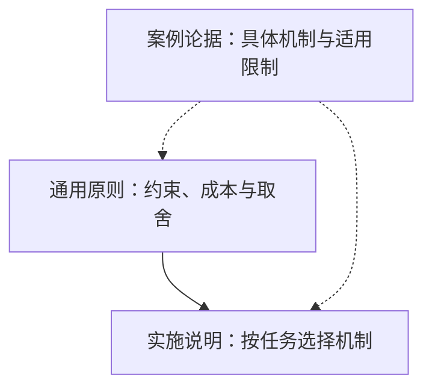

# HPC_Style_For_AI

_面向各类 HPC 项目的通用设计与评审原则，0.2.0。_

目标不是让新代码“长得像某个成熟库”，而是让 AI 能从计算契约、资源约束和工程代价推导设计。框架、模板、布局、并行模型和平台适配，都应是这个推导的结果，而非预设答案。

## 从原则进入，而非从案例进入

[通用原则](<skills/hpc-style-for-ai/references/rules.md>)是主文档，不依赖 AMReX、C++、网格或 CUDA。它按设计问题组织：

| 设计问题 | 原则 |
| --- | --- |
| 什么才算正确，代价主要在哪里 | G01 计算契约；G02 主导成本与关键路径 |
| 数据与程序怎样组织 | G03 表示、访问、放置与生命周期；G04 稳定语义与抽象边界 |
| 信息和工作何时、如何执行 | G05 绑定时机；G06 粒度与局部性；G07 依赖与完成；G08 整体完成时间 |
| 如何控制长期工程成本 | G09 特化预算；G10 可推理的代码结构；G11 验证闭环；G12 可移植性契约 |

例如，“为什么使用模板元编程”先转化为“哪些信息值得提前确定”。之后才比较编译期特化、运行时计划、JIT、批量分派和普通动态执行。这样既保留模板的设计动机，也让原则适用于其他语言和算法。

## 内容分成三个层次



- **原则层**：[十二条通用原则](<skills/hpc-style-for-ai/references/rules.md>)。AI 默认读取，不要求复制任何项目的架构。
- **实施层**：[绑定时机与模板元编程](<skills/hpc-style-for-ai/references/binding-strategies.md>)。仅在相关任务中加载，讨论实现选择而非指定唯一方案。
- **论据层**：[原则与证据的联系](<docs/principle-evidence.md>)、[AMReX Base 案例](<docs/base-study.md>)和[源码账本](<evidence/base-evidence.json>)。支持和限定设计解释，不充当规范目录。

当前源码案例只有第一轮 AMReX Base 阅读，固定到提交 `7802c6ef997f8350c26d07a2e7326a4fe0c77fb8`。没有声称已完成多项目审计或跨平台性能验证；原则中的工程建议与直接源码观察明确区分。

## 给 AI 使用

读取[技能入口](<skills/hpc-style-for-ai/SKILL.md>)及其默认引用的原则，随后提交具体任务。例如：

```text
使用 hpc-style-for-ai 设计这个稀疏迭代求解流程。
先确定数值契约、重复使用的结构、数据运动与关键路径，
再选择预处理计划、数据表示和并行粒度。不要预设模板或某种执行框架。
说明每个重要选择的收益、代价和验证方法。
```

```text
使用 hpc-style-for-ai 评审这段 Fortran/Python 科学计算流程。
从端到端成本、隐式复制、工作粒度、依赖与数值验证入手。
不要为了套用案例而更换语言或引入网格对象体系。
```

对稠密计算，可以从复用和计算强度切入；对稀疏或图任务，可以从不规则访问、预处理摊销和长尾切入；对重复变换，可以从计划构建、重排和通信切入。这些只是原则应用的假设场景，不是已经实施的优化成果。

支持 skill 目录的工具可复制整个 `skills/hpc-style-for-ai/`，保留入口和 references 的相对布局。其核心内容不依赖外部源码仓库或证据附录即可加载。

### DSH 插件

插件按需注册 `hpc-style-for-ai`，不向全局提示词强制注入规则。适配目标是 DSH skills 服务 `0.2.1-rc.5`，Node.js 22+。

```bash
# 安装固定版本的 GitHub Release 包；将 web 换成实际使用的 profile。
dsh plugin --profile web add https://github.com/WangZW928/HPC_Style_For_AI/releases/download/v0.2.0/dsh-hpc-style-for-ai-0.2.0.tgz

# 从源码检查和打包。
git clone https://github.com/WangZW928/HPC_Style_For_AI.git
cd HPC_Style_For_AI
npm run check
npm pack
```

按宿主提示启用、刷新会话并检查技能目录。打包不等于当前会话已经安装，本项目不自动修改 profile。包名为 `dsh-hpc-style-for-ai`，技能名为 `hpc-style-for-ai`。

## 检查范围

```bash
# 文档、原则和 provider 契约检查
npm run check
# 可选：核对 AMReX 案例的固定提交、26 条引文与源文件状态
python3 scripts/validate.py --source ../amrex
# 可选：隔离环境中的真实 DSH registry 发现、加载与资源定位
node scripts/host-smoke.mjs /absolute/path/to/dsh-runtime
```

结构检查验证原则层与案例层的依赖方向、编号、链接和技能加载，不证明 AI 在所有任务中都会正确应用原则。Mermaid 仅做结构检查，没有可视化验收。

保留的[独立 C++ 示例](<examples/owner_view.cpp>)只演示一组类型与执行边界，不是规范蓝图。它已有 Serial/OpenMP 正确性和标量 sanitizer 检查；空域、尺寸不匹配、const、同址 alias 等测试不代表所有 HPC 机制已覆盖。其[构建入口](<CMakeLists.txt>)支持以下命令：

```bash
cmake -S . -B build-serial -DCMAKE_BUILD_TYPE=Release
cmake --build build-serial
ctest --test-dir build-serial --output-on-failure
# OpenMP：另用 -DHPC_STYLE_OPENMP=ON 配置。
```

未进行 AMReX 性能基准，也没有 MPI、加速器后端或通用性能收益保证。0.2.0 主要调整原则的抽象层级与组织，不新增这些实现。

## 后续维护

先提出独立于具体项目的设计问题，再检查论据支持了什么、遗漏了什么。新增案例可以支持、限制或促使修改原则，但不因它使用某种 API，就把那种 API 的组织方式推广为所有项目的要求。

公开项目地址：[WangZW928/HPC_Style_For_AI](https://github.com/WangZW928/HPC_Style_For_AI)。原创代码和文档采用 [MIT 许可](<LICENSE>)；AMReX 引文与片段继续保留[原版权与 BSD-3-Clause 许可](<third_party/AMReX-LICENSE>)，归属说明见 [NOTICE](<NOTICE>)，不代表官方认可。

发行包通过 GitHub Release 分发；npm 包名仅用于包标识，不代表已经发布到 npm。市场收录由各目录维护者审核，提交申请不等于已经上架。
