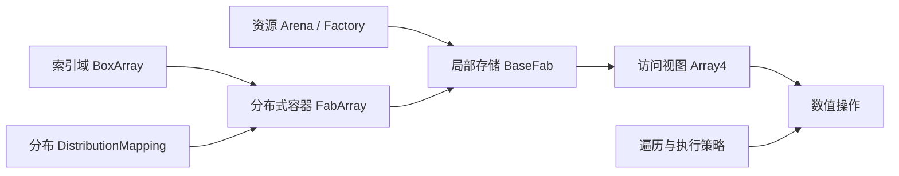

# AMReX Base：HPC 设计原则的一个源码案例

_案例层；第一轮源码阅读，2026-11-19。现行设计规范以通用问题组织，本篇仅提供机制、动机和限制。_

原则入口见[通用原则](<../skills/hpc-style-for-ai/references/rules.md>)，证据的支持边界见[案例与原则的联系](<principle-evidence.md>)。本篇的对象与文件顺序只服务于源码解释，不作为新项目的架构要求。

## 阅读边界与一个关键判断

本轮固定到本地 AMReX fork 的提交 `7802c6ef997f8350c26d07a2e7326a4fe0c77fb8`，选择 Base 中数据容器、访问视图、工厂、模板设施、遍历、通信和内存接口进行审读。它不是 Base 全量审计，也没有执行 AMReX 的性能基准。具体范围和可机器核对的引文见[证据账本](<../evidence/base-evidence.json>)。

值得迁移的不是“多写模板、加上 GPU 宏”，而是：**把数据和资源的成本组织进接口，让热点只保留必要的工作。** 下文的源码事实有证据编号；设计动机是对实现的解释；编码规范则是面向新工程的建议。三者不互相替代。

## 框架：先拆开域、数据、分布和执行

Base 不是一个职责单一的小库。其[构建入口](<https://github.com/WangZW928/amrex/blob/7802c6ef997f8350c26d07a2e7326a4fe0c77fb8/Src/Base/CMakeLists.txt#L95-L164>)将 I/O、索引空间、矩形域集合、FAB 数据和 FAB 集合分组；这些是基础设施职责，不意味着模块目录里每一部分已经完全解耦（E01）。

| 对象 | 主要回答的问题 | 迁移时保留的概念 |
| --- | --- | --- |
| `Box` / `BoxArray` | 逻辑索引域在哪里，由哪些块组成 | 域与数值存储分离 |
| `DistributionMapping` | 每块归哪个进程 | 拓扑与分布策略分离 |
| `BaseFab<T>` / `FArrayBox` | 单块数据如何存储与管理 | 带域、组件和资源策略的数据块 |
| `FabArray<FAB>` / `MultiFab` | 多块数据如何组成分布式对象 | 组合局部块与通信语义 |
| `ArrayND` / `Array4` | 核函数如何访问数据 | 不承担所有权的轻量视图 |
| `MFIter` / `ParallelFor` | 如何遍历块、tile 与元素 | 执行策略与数值操作分离 |
| `Arena` / `FabFactory` | 数据放在哪里、如何创建回收 | 可替换资源策略 |

这张表是职责地图，不是严格 UML。`FabArray<FAB>` 继承 `FabArrayBase`；`MultiFab` 继承 `FabArray<FArrayBox>`，其注释明确类比 `FArrayBox` 对 `BaseFab<Real>` 的扩展。`DistributionMapping::ProcessorMap()` 则显式提供块到进程的映射（E02、E03）。[^hierarchy]



这种拆分的价值在变化方向上。调整进程分布时不必重新设计逐元素表达式；更换内存来源时不必把分配分支散进核函数；修改 tile 粒度时数学操作仍可保持不变。这里的“可以分离”是设计空间，不是宣称实际所有调用都无耦合。

新项目无需复制 AMR 的整套层次。一个单机矩阵算法也许只需要 owner、view、遍历函数和 workspace。先找到真实变化轴，再决定是否引入分布式容器或工厂，对应规范 G04。

## 模板：为什么用，以及哪些事不该交给它

### 例一：固定类型和秩，保留动态形状

当前版本的 [Array4 定义](<https://github.com/WangZW928/amrex/blob/7802c6ef997f8350c26d07a2e7326a4fe0c77fb8/Src/Base/AMReX_Array4.H#L1300-L1306>)与部分旧版本不同（E07b）：

```cpp
template<typename T>
using Array4 = ArrayND<T, 4, true>;
```

底层 [ArrayND](<https://github.com/WangZW928/amrex/blob/7802c6ef997f8350c26d07a2e7326a4fe0c77fb8/Src/Base/AMReX_Array4.H#L281-L318>) 将 `T`、`N` 和最后一维是否表示组件作为模板参数，但地址、stride、上下界是对象状态（E07；以下省略了注释和属性宏）：

```cpp
template<typename T, int N, bool last_dim_component = false>
struct ArrayND {
    T* p = nullptr;
    detail::Stride<N-1> stride{};
    IntVectND<N> begin{1};
    IntVectND<N> end{0};
};
```

**为什么值得静态化？** 元素类型决定返回引用的类型、可执行的运算和 const 权限；固定秩决定合法下标数量、stride 存储大小和可用重载。若改成 `void* + runtime type code + runtime rank`，接口就需要额外负责类型恢复和维数解释。模板把这部分合法性提前处理，也让具体访问算术对编译器可见。

**为什么尺寸仍动态？** 网格 extent、组件数和数据地址来自运行输入。把每种长度都作为模板参数，会把原本一份算法变成大量实例。当前实现已经说明：类型静态与形状动态可以共存，并不需要“全编译期”。

315–318 行还限制从可写视图到 const 元素视图的转换。注意 `const Array4<T>` 是 const 句柄，而非 `Array4<const T>`；后者才约束通过视图修改元素。轻量视图也不延长底层内存的存活期。对应 G03、G05。

类模板和别名主要属于泛型编程；检查类型关系的 trait、受约束重载和类型驱动裁剪，才是这里重点讨论的模板元编程。把二者分清，有助于避免将一切 C++ 模板代码都解释成性能技巧。

### 例二：在接口处检查实际需要的表达式

[TypeTraits](<https://github.com/WangZW928/amrex/blob/7802c6ef997f8350c26d07a2e7326a4fe0c77fb8/Src/Base/AMReX_TypeTraits.H#L197-L213>) 的核心关系很短（E09）：

```cpp
using call_result_t = decltype(std::declval<T>()(std::declval<Args>()...));
struct IsCallable : IsDetected<detail::call_result_t, T, Args...> {};
```

这里检查的是 `f(args...)` 是否成立，不是任意一种 `std::invoke` 调用语义。208–211 行还解释：额外的通用调用包装会增加 debug 调用栈、模板实例化并遮蔽泛型代码。作者并非只追求“越通用越好”，而是让抽象边界贴近真实调用方式。

具体 callable 作为模板参数传入，能让实现看见其类型；这给内联、常量传播和消除间接调用提供机会。它不证明调用一定内联，也不证明 callable 适合设备、捕获有效或没有竞争。

迁移时先检查标准设施是否足够；新 C++20 工程可优先用 concepts 诊断约束。运行期插件、稳定 ABI 或开放类型集合依然可以在控制层使用类型擦除。需要避免的是把每次逐元素运算都变成复杂动态分派，而不是全面禁用动态机制。对应 G05、G09。

### 例三：`if constexpr` 与普通 `if` 处理不同问题

[BaseFab::define](<https://github.com/WangZW928/amrex/blob/7802c6ef997f8350c26d07a2e7326a4fe0c77fb8/Src/Base/AMReX_BaseFab.H#L1466-L1489>) 中（E11）：

```cpp
if constexpr (std::is_same_v<T,float> || std::is_same_v<T,double>) {
    if (amrex::InitSNaN() && this->truesize > 0) {
        // 随后按 launch region 和 Arena 可访问性选择执行路径
    }
}
```

外层判断属于类型事实：只给 float/double 实例保留这组初始化逻辑。内层判断属于运行状态：是否开启初始化、当前容量多大、当前执行区域和内存是否适合该路径。编译期裁剪解决“该类型是否适用”，普通 `if` 解决“这一次是否执行”。模板没有取代运行时。

[跨类型 Copy](<https://github.com/WangZW928/amrex/blob/7802c6ef997f8350c26d07a2e7326a4fe0c77fb8/Src/Base/AMReX_FabArray.H#L185-L237>) 也把两层分开：SFINAE 要求源目标 FAB 满足条件且元素类型可转换；遍历范围、组件数和是否走融合候选路径仍在运行期决定（E11b）。这里还要保留一个业务边界：`is_convertible` 不等于无精度损失，更不等于物理单位正确。新工程若禁止窄化，应建立额外约束或显式转换接口。

对应 G05，反面例子是：只因尺寸会影响速度，就把所有尺寸都模板化。

### 例四：静态展开解决常量索引，不自动加速大循环

[constexpr_for](<https://github.com/WangZW928/amrex/blob/7802c6ef997f8350c26d07a2e7326a4fe0c77fb8/Src/Base/AMReX_ConstexprFor.H#L26-L34>) 的递归主体如下（E10）：

```cpp
if constexpr (I < N) {
    f(std::integral_constant<decltype(I), I>());
    constexpr_for<I+1, N>(f);
}
```

这里每次给 `f` 的索引都带有编译期常量类型，适合访问异构 tuple，或让不同索引选择不同类型/实现。若只是遍历百万个同类型元素，普通循环更直接，编译器仍可向量化和展开。

还要区分“展开结构”和“计算结果”：循环体若读写运行时数组，其运算依然发生在运行时。过度展开可能拉大指令体积，增加寄存器压力和编译负担。对应 G05、G09。

### 例五：归约操作的组合是小而稳定的结构

[MinMax](<https://github.com/WangZW928/amrex/blob/7802c6ef997f8350c26d07a2e7326a4fe0c77fb8/Src/Base/AMReX_Reduce.H#L1032-L1043>) 将 min/max 合成一个操作列表（E12）：

```cpp
ReduceOps<ReduceOpMin,ReduceOpMax> reduce_op;
ReduceData<T,T> reduce_data(reduce_op);
// 单次 eval 的 callable 返回 {v[i], v[i]}
```

而 [CPU eval](<https://github.com/WangZW928/amrex/blob/7802c6ef997f8350c26d07a2e7326a4fe0c77fb8/Src/Base/AMReX_Reduce.H#L1373-L1384>) 仍然用普通 `for (N i = 0; i < n; ++i)` 走数据，再由静态操作列表更新 tuple（E12b）。因此静态的是“做哪几个归约、对应什么结果类型”，动态的是“这次处理多少个元素”。

这给共享遍历和消除逐元素操作类型判断提供机会。但源码不构成实际带宽或加速比证据；组合过宽还可能增加寄存器和代码体积。浮点归约需要另行规定顺序、容差、NaN 和可复现性，类型列表只组织操作，不替代数值分析。

### 模板决策表

| 要决定的事实 | 首选表达 | 原因与代价 |
| --- | --- | --- |
| 元素类型、const、合法表达式 | 类型参数与约束 | 提前诊断；承担实例化和诊断复杂度 |
| 小且稳定的秩、固定操作列表 | 有限模板轴 | 生成具体结构；约束组合数 |
| 数组长度、输入阈值、步数、地址 | 运行时值 | 避免按输入规模复制代码版本 |
| 资源类型、工厂、运行期插件 | 普通接口或动态多态 | 隔离开放扩展；避免搬入逐元素热点 |
| 编译器注解和后端语法 | 窄预处理/适配层 | 处理语言工具链差异，不伪装成算法策略 |

## 高性能：先降低数据运动，再调整执行粒度

### 访问布局是算法接口的一部分

[Array4 元素访问](<https://github.com/WangZW928/amrex/blob/7802c6ef997f8350c26d07a2e7326a4fe0c77fb8/Src/Base/AMReX_Array4.H#L949-L967>) 的地址计算含有（E13，节选 GPU/Debug 分支）：

```cpp
p[(i-begin.vect[0]) +
  (j-begin.vect[1]) * stride.a[0] +
  (k-begin.vect[2]) * stride.a[1] +
                  n * stride.a[2]];
```

第一索引连续，组件跨平面。它对应 [BaseFab 的布局说明](<https://github.com/WangZW928/amrex/blob/7802c6ef997f8350c26d07a2e7326a4fe0c77fb8/Src/Base/AMReX_BaseFab.H#L167-L171>)：空间索引变化快于组件。对逐组件遍历，这种布局为连续访存提供条件；如果算法总是消费单个位置的所有组件，代价可能不同。因此可复用的是“布局与访问模式共同设计”，不是把 SoA 推为唯一标准。

内存管理方面，[BaseFab::resize](<https://github.com/WangZW928/amrex/blob/7802c6ef997f8350c26d07a2e7326a4fe0c77fb8/Src/Base/AMReX_BaseFab.H#L241-L254>) 的说明强调默认容量只增不减，以避免反复分配（E08）。这用保留内存换分配复用，适合可复用 workspace，但峰值内存紧张或尺寸突变时要重新评估。对应 G02、G03。

### CPU 分块与 SIMD：读访存表达式，而不只读 pragma

[CPU transpose](<https://github.com/WangZW928/amrex/blob/7802c6ef997f8350c26d07a2e7326a4fe0c77fb8/Src/Base/AMReX_BaseFabUtility.H#L219-L245>) 使用 32×32 分块、OpenMP 和 SIMD 提示（E13b）：

```cpp
AMREX_PRAGMA_SIMD
for (int k = k0; k < kmax; ++k) {
    pdst[i + k*nxy] = psrc[k + i*nyz];
}
```

固定 `i` 时输入随 `k` 连续，输出却以 `nxy` 跨步；它是转置，不是“两边都顺序访存”的示例。分块是在局部范围内处理这种冲突，具体收益还要看缓存、编译器和问题规模。`32` 是该实现的策略，不是跨硬件常数；SIMD 提示也不证明实际生成了理想向量指令。

再看[默认三维 tile](<https://github.com/WangZW928/amrex/blob/7802c6ef997f8350c26d07a2e7326a4fe0c77fb8/Src/Base/AMReX_FabArrayBase.cpp#L32-L57>)：GPU 构建设置为 `(1024000,1024000,1024000)`，普通 CPU 分支为 `(1024000,8,8)`（E14）。[TilingIfNotGPU](<https://github.com/WangZW928/amrex/blob/7802c6ef997f8350c26d07a2e7326a4fe0c77fb8/Src/Base/AMReX_MFIter.H#L11-L15>) 根据构建和执行区域选择是否 tiling（E04）。这些差异说明，执行抽象的价值是留出策略调整点，而非迫使 CPU 与 accelerator 使用同一个任务粒度。

迁移到其他后端时，共享数学语义、域和视图契约；分别确定 cache tile、SIMD 维、线程任务、设备 launch 等策略。通用 API 不必暴露 warp 或 block size。对应 G12。

### 通信重叠：需要窗口、进展和正确依赖

[FillBoundary 通信实现](<https://github.com/WangZW928/amrex/blob/7802c6ef997f8350c26d07a2e7326a4fe0c77fb8/Src/Base/AMReX_FabArrayCommI.H#L154-L165>) 在发送提交后调用 `FillBoundary_test()`，随后写道（E16）：

> Do the local work. Hope for a bit of communication/computation overlap.

“Hope”很准确：有独立本地工作，也还需要 MPI progress、足够工作量、缓冲管理和计时证据。[同步包装](<https://github.com/WangZW928/amrex/blob/7802c6ef997f8350c26d07a2e7326a4fe0c77fb8/Src/Base/AMReX_FabArray.H#L3387-L3393>) 则直接相继调用 `FillBoundary_nowait` 和 `FillBoundary_finish`（E16b），没有在两者之间插入调用者计算窗口。

新工程可采用 `begin → 独立计算 → finish → 消费接收数据`，但“独立”需要逐区确认：尚在发送的缓冲不被覆盖，接收区域不被提前读写，owner 和 request 存活到规定完成点。只有异步 API 名字不构成完成语义。对应 G07、G08。

### 内存策略和同步边界都要读实际行为

[Arena 接口](<https://github.com/WangZW928/amrex/blob/7802c6ef997f8350c26d07a2e7326a4fe0c77fb8/Src/Base/AMReX_Arena.H#L178-L222>) 明确区分 host/device 可访问性，且二者可以同时成立（E15）。这种抽象把资源策略从数值核中移出，却不意味着所有内存的访问成本相同。

更有提醒意义的是 [streamOrderedFree 基类](<https://github.com/WangZW928/amrex/blob/7802c6ef997f8350c26d07a2e7326a4fe0c77fb8/Src/Base/AMReX_Arena.cpp#L130-L139>)：对非 stream-ordered Arena 直接调用 `free(pt)`（E15b）。名字并不保证任意 allocator 都能延后回收。另一个方向上，[MFIter Finalize](<https://github.com/WangZW928/amrex/blob/7802c6ef997f8350c26d07a2e7326a4fe0c77fb8/Src/Base/AMReX_MFIter.cpp#L245-L263>) 中存在 stream 同步和 OpenMP 同步边界（E17）；[MFItInfo](<https://github.com/WangZW928/amrex/blob/7802c6ef997f8350c26d07a2e7326a4fe0c77fb8/Src/Base/AMReX_MFIter.H#L19-L67>) 提供相关控制选项。关闭默认同步后，调用方就需要明确承担最后使用与释放之间的依赖。

所以 RAII 负责资源生命周期组织，却不自动证明任意异步消费者已完成。该保留同步还是省掉它，先看具体完成契约，再看端到端收益。对应 G03、G07。

## 性能与维护：抽象并不等于越少越好

最直接的反例是 [FabFactory](<https://github.com/WangZW928/amrex/blob/7802c6ef997f8350c26d07a2e7326a4fe0c77fb8/Src/Base/AMReX_FabFactory.H#L48-L70>)：它本身是类模板，同时包含虚的 create、destroy、clone 和 `nBytes`；`nBytes` 内部又有 `if constexpr`（E05）。模板和运行时多态在同一设计中各司其职。

另一个反例是 [BaseFab 声明](<https://github.com/WangZW928/amrex/blob/7802c6ef997f8350c26d07a2e7326a4fe0c77fb8/Src/Base/AMReX_BaseFab.H#L181-L233>)。前面的历史注释称其不是 polymorphic class，但当前声明中有 `virtual ~BaseFab()`（E06）。因此本轮以实际声明为准，不把注释照抄成“BaseFab 没有虚函数”的风格结论。对成熟代码的蒸馏，需要保留这种纠偏能力。

| 手段 | 可能获得什么 | 需要支付什么、何时选更简单的方案 |
| --- | --- | --- |
| 模板 callable / 有限特化 | 暴露具体操作与常量 | 实例化、产物体积、诊断；冷路径可用普通接口 |
| owner/view 与 alias | 避免数据搬运 | 别名、const、失效和异步依赖需要显式契约 |
| 容量复用 / arena | 减少分配频次、集中资源策略 | 保留容量、碎片和可观测性；小临时对象可用标准容器 |
| 算子/归约融合 | 减少遍历或 launch 的机会 | 代码体积、寄存器压力；重型融合未必合算 |
| 分离提交/完成 | 提供通信与计算重叠窗口 | 状态与缓冲生命周期；没有独立工作就保持同步路径 |
| 后端分支 | 贴近执行与编译工具链 | 多配置测试和分支漂移；算法层避免重复硬件条件 |

取舍标准应是目标工作负载的收益，而非模板层数、宏数量或抽象数量。新增特化至少列出实例化轴、受益热点、正确性测试和基准计划。未测量时标为优化假设，已编译也只证明有限的工具链可接受它。

## 代码组织与命名：哪些值得照做，哪些只需尊重

AMReX 使用项目文件前缀、命名空间、头文件中的模板定义、运行时 `.cpp`、维数/后端专用文件和构建条件组合。比如 [GpuLaunch 的语法适配](<https://github.com/WangZW928/amrex/blob/7802c6ef997f8350c26d07a2e7326a4fe0c77fb8/Src/Base/AMReX_GpuLaunch.H#L35-L45>) 用预处理区分 CUDA/HIP（E18）。这是后端语言差异的适配，不是科学算法应被 CUDA 特化的理由。

[官方贡献指南](<https://github.com/WangZW928/amrex/blob/7802c6ef997f8350c26d07a2e7326a4fe0c77fb8/CONTRIBUTING.md#L210-L251>) 明确规定四空格、单语句块加花括号、函数声明/定义名与左括号间留空格、成员使用 `m_`，并要求不要顺手重排无关代码（E19）。这些可以作为 AMReX 贡献时的硬约定。

但 [FabArrayBase 接口](<https://github.com/WangZW928/amrex/blob/7802c6ef997f8350c26d07a2e7326a4fe0c77fb8/Src/Base/AMReX_FabArrayBase.H#L77-L131>) 同时出现 `nComp`、`boxArray`、`DistributionMap`、`local_size`（E20）。因此不存在一套可以从历史 API 直接抽出的统一大小写方案。新工程应选择自己的稳定规则，优先让命名表达对象语义和显著成本；学习职责分层，不必复制 `.H` 后缀、所有缩写和历史前缀。对应 G10。

## 如何把这轮阅读交给 AI

[通用原则](<../skills/hpc-style-for-ai/references/rules.md>)独立按设计问题组织为 G01–G12；本篇用于提供局部论据和反例，而非决定规范结构。[技能入口](<../skills/hpc-style-for-ai/SKILL.md>)只保留执行方法：先识别数据和正确性契约，再选择必要抽象，最后以测试与测量审核优化。

后续扩展宜沿具体调用链继续，而不是先把所有目录都归成“最佳实践”：例如追踪一次数值算子的分布、打包、内核和等待，或用同一个 CPU workload 比较普通循环、分块与模板特化。当前版本尚未提供这类 AMReX 运行时基准，也未覆盖全部内存实现、全部归约语义和编译器配置。

[^hierarchy]: 固定版本的声明与语义说明：[MultiFab](https://github.com/WangZW928/amrex/blob/7802c6ef997f8350c26d07a2e7326a4fe0c77fb8/Src/Base/AMReX_MultiFab.H#L24-L40)、[FabArray](https://github.com/WangZW928/amrex/blob/7802c6ef997f8350c26d07a2e7326a4fe0c77fb8/Src/Base/AMReX_FabArray.H#L310-L360)、[DistributionMapping](https://github.com/WangZW928/amrex/blob/7802c6ef997f8350c26d07a2e7326a4fe0c77fb8/Src/Base/AMReX_DistributionMapping.H#L119-L136)。其余证据的固定提交 URL 可由[账本](<../evidence/base-evidence.json>)中的 browse_base、path、start/end 重建；正文的源码链接固定到同一公开提交，阅读案例不依赖本地目录布局。
